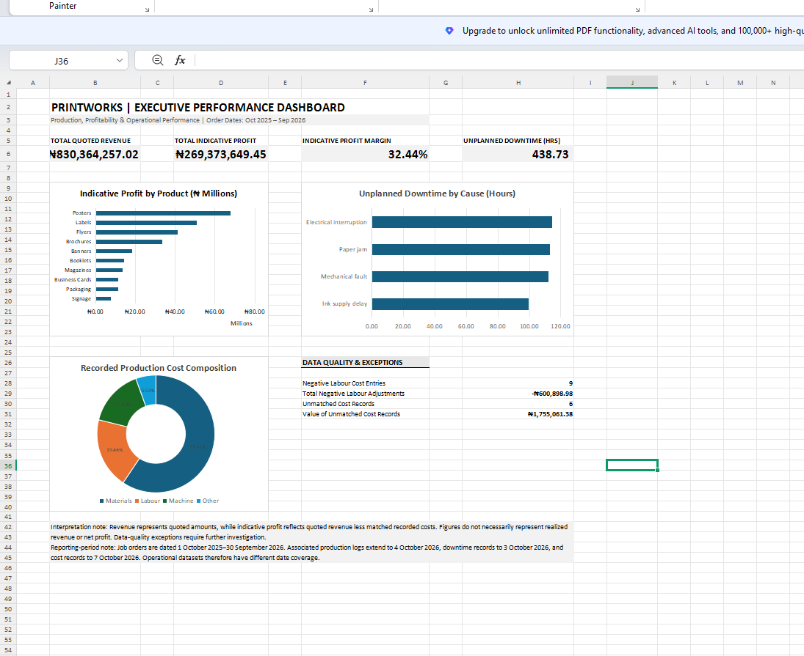

# PrintWorks | Business Performance & Operational Efficiency Analysis

**Tools:** WPS Spreadsheets · **Industry:** Commercial printing · **Order dates:** 1 October 2025–30 September 2026  
**Data disclosure:** This portfolio project analyzes simulated commercial printing operations data.

## Executive summary

This project reconciles customer orders, job costs, production activity and machine downtime to evaluate indicative profitability, operational efficiency and reporting quality. It delivers an analytical workbook, executive dashboard and five evidence-based management recommendations. Results are analytical findings, not implemented business outcomes.

| KPI | Result |
|---|---:|
| Quoted revenue (matched-cost jobs) | ₦830,364,257.02 |
| Matched recorded production costs | ₦560,990,607.57 |
| Indicative profit | ₦269,373,649.45 |
| Aggregate indicative margin | 32.44% |
| Recorded unplanned downtime | 438.73 hours |



## Technical Skills Demonstrated

- **Data Cleaning & Validation:** Identified missing cost matches, negative labour adjustments, quantity discrepancies and production-duration exceptions.
- **Data Reconciliation:** Connected job orders, production logs and job costs using Job IDs.
- **Spreadsheet Analytics:** Applied `IF`, `IFERROR`, `SUMIFS`, lookup functions, aggregation formulas and conditional calculations.
- **Financial Analysis:** Evaluated quoted revenue, recorded production costs, indicative profit, margins and product profitability.
- **Operational Analysis:** Calculated printing throughput, production hours and machine downtime.
- **Data Visualization:** Developed an executive dashboard featuring KPIs, product profitability, downtime causes and cost composition.
- **Business Intelligence:** Translated analytical findings into five evidence-based management recommendations.

**Tools:** WPS Spreadsheets (Excel-compatible formulas and workbook).

## Business questions

Which products drive indicative profitability? How does financial contribution relate to printing time? Which downtime causes dominate interruptions? What cost and production exceptions limit reporting reliability?

## Data sources

| Dataset | Records | Coverage |
|---|---:|---|
| Job Orders | 2,347 | 1 Oct 2025–30 Sep 2026 (order dates) |
| Job Costs | 2,285 | 1 Oct 2025–7 Oct 2026 |
| Production Logs | 6,526 | 1 Oct 2025–4 Oct 2026 |
| Machine Downtime | 398 | 4 Oct 2025–3 Oct 2026 |

The record counts are **not** counts of distinct jobs. Operational records extend beyond the order-date range; no strict 12-month filtering is claimed for the operational totals.

## Data preparation and quality checks

- Matched costs to job orders using Job ID; 2,279 jobs have matched costs and 68 job orders lack matching costs.
- Compared recorded order and production quantities; validated printing-stage durations before throughput calculations.
- Calculated job costs from material, labour, machine and other cost components.
- Identified **6 unmatched cost records (₦1,755,061.38)** and **9 negative labour entries (−₦600,898.98)**. Exceptions were retained for investigation, not automatically deleted.
- Excluded **80 matched-cost jobs** without valid printing records from the comparable profit-per-printing-hour calculation. These jobs represent approximately ₦7.79m, or 2.89% of indicative profit.

## Analytical methodology and representative formulas

**Job indicative profit** (`Job Orders - Clean!S2`):

```excel
=IF(Q2="MATCHED",H2-R2,"")
```

**Job indicative margin** (`Job Orders - Clean!T2`):

```excel
=IF(AND(Q2="MATCHED",H2>0),S2/H2,"")
```

**Product indicative profit share** (`Product Profitability!G2`):

```excel
=IFERROR(E2/$E$12,0)
```

**Machine printing throughput** (`Machine Efficiency!D2`):

```excel
=IFERROR(C2/B2,0)
```

**Machine unplanned downtime hours** (`Machine Efficiency!G2`):

```excel
=SUMIFS('Machine Downtime'!$H$2:$H$399,'Machine Downtime'!$C$2:$C$399,A2,'Machine Downtime'!$G$2:$G$399,"Unplanned")/60
```

The overall margin is **total indicative profit / total quoted revenue**, not the simple average of product margins. Throughput is total validated printing units divided by total validated printing hours, not the unweighted average of log-level rates. Zero printing throughput for prepress/finishing machines means no Printing-stage activity, not necessarily inefficiency.

## Dashboard design

The dashboard combines four headline KPIs with product-profit ranking, unplanned downtime by cause, production cost composition and a data-quality exception panel. Recorded production cost mix: **materials 59.41%; labour 19.46%; machine 15.60%; other 5.53%**.

## Five findings and management recommendations

### 1. Posters: disproportionate profit contribution

**Evidence:** Posters generated ₦67.63m in indicative profit (25.11% of total) from 8.78% of matched jobs, and ₦69,839.74 per comparable printing hour.

**Recommendation:** Evaluate demand and LF-02 capacity before expanding poster production.

**Qualification:** Quotation-based profitability; complete costs and realized sales unverified.

### 2. LF-02: recoverable production time

**Evidence:** LF-02 recorded 59.78 downtime hours, including 34.78 unplanned hours. A hypothetical 50% recovery would free 17.39 hours, or ~1,061 posters at historical throughput.

**Recommendation:** Investigate failure causes, scheduling and the economics of preventive maintenance.

**Qualification:** The recovery scenario is theoretical capacity, not additional sales or profit.

### 3. Cost records: reconciliation exceptions

**Evidence:** Nine negative labour entries totalled −₦600,898.98; six unmatched cost records totalled ₦1,755,061.38.

**Recommendation:** Reconcile adjustments and unmatched Job IDs before relying on job-level margins.

**Qualification:** Negative entries can be legitimate accounting adjustments.

### 4. Downtime: concentrated interruption causes

**Evidence:** Electrical interruptions (114.28h), paper jams (113.05h) and mechanical faults (112.08h) together account for 77.37% of unplanned downtime.

**Recommendation:** Prioritize root-cause investigations using feasibility, cost and potential recoverable time.

**Qualification:** Hours alone do not measure financial loss or justify investment.

### 5. Throughput versus financial value

**Evidence:** Labels processed 2,635.88 units/h versus 61.01 for Posters, but Posters generated ₦69,839.74 per comparable printing hour versus ₦37,622.40 for Labels.

**Recommendation:** Use product-specific throughput alongside profit per comparable printing hour.

**Qualification:** Different products and unit specifications are not directly interchangeable.

## Limitations and interpretation

1. **Quoted versus realized revenue:** quotations are not confirmed cash collections or completed sales.
2. **Incomplete cost coverage:** recorded job costs may omit overhead, taxes and other expenses; indicative profit is not net profit.
3. **Cost-record exceptions:** unmatched costs and negative labour adjustments require investigation.
4. **Incomplete production coverage:** comparable profit-per-printing-hour excludes 80 matched-cost jobs without valid printing records.
5. **Different reporting periods:** cost, production and downtime records extend beyond September 2026.
6. **Missing scheduled capacity:** downtime hours cannot establish true machine availability or utilization.
7. **Different product units:** raw throughput is not directly comparable across dissimilar print products.

## Project outcome and reproducibility

**Completed:** workbook-based cleaning, reconciliation, profitability analysis, machine/downtime summaries, dashboard and management insights. **Not claimed:** implemented changes, realized cost savings, revenue growth or measured operational improvement.

To inspect the work, open [`PrintWorks_Analysis.xlsx`](PrintWorks_Analysis.xlsx) in WPS Spreadsheets or Excel. Start with `Executive Dashboard` and `Management Insights`; then inspect `Job Orders - Clean`, `Job Costs`, `Production Logs - Clean`, `Product Profitability`, `Machine Efficiency` and `Downtime Causes`. Formula results and display may differ across spreadsheet applications; refresh/recalculate if necessary.

**Evidence note:** The dashboard screenshot is from the working spreadsheet. Calculations and source records are in the workbook. The displayed figures were checked for consistency against the previously reconciled workbook summaries; this is not a formal independent audit of every underlying record.
